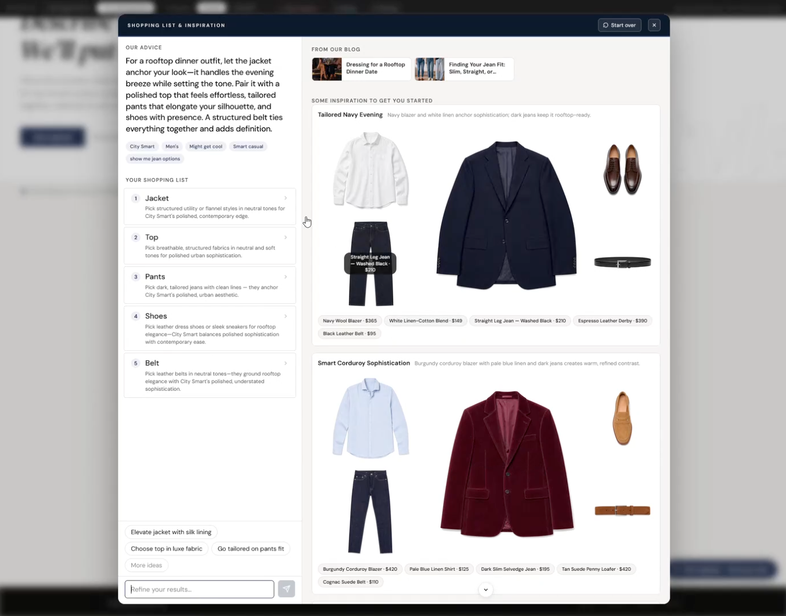

# Greeter



An intent-driven shopping assistant prototype for the **MACH Alliance Agent Solution Studio**.

A shopper describes a goal in natural language. The assistant runs a short guided
conversation, builds a structured intent model, then assembles a curated collage of
products — hero, supporting, and accent items chosen and weighted by the AI — alongside
matched CMS content. It ships as a floating widget embedded on a mockup retailer site.

The retailer mockup pages (`host/index.html`, `search.html`, `product.html`, `guide.html`) are
deliberately retailer-branded, not MACH Alliance-branded — they're simulating someone else's
storefront. The tool-facing pages (the demo-control bar on the host page, `host/settings.html`)
carry the official MACH Alliance logo and brand accent instead.

---

## Quick start

You need a [Vercel AI Gateway](https://vercel.com/docs/ai-gateway) API key. Nothing else is
required — Greeter runs entirely against local sample data by default, no other accounts
needed to see it working end to end.

```bash
git clone <this-repo>
cd greeter
cp .env.example .env
```

Open `.env` and set:

```env
AI_GATEWAY_API_KEY=vck_...
```

Then pick whichever of these you already have installed — same app, same `.env`, either way:

**Have Docker?**

```bash
docker compose up
```

**Don't have Docker, have Node.js 22+?**

```bash
npm install
npm run build
npm run dev
```

(The build step is one-time — it compiles the React widget into `dist/`, which the server reads
directly. `npm run dev` hot-reloads server-side TypeScript changes instantly; re-run `npm run
build` after editing anything in `src/components/`. The Docker path rebuilds the image instead —
`docker compose up --build` — after any code change, since it's a self-contained image rather
than a live dev loop.)

Visit `http://localhost:<PORT>` (set in `.env`). Click the pulsing floating button,
bottom-right, to open the widget.

> The Docker image sets `NODE_ENV=production`, which turns the operator routes **off** by
> default: `/debug/*` returns `404`, and the settings page still loads but its controls no
> longer do anything. `docker-compose.yml` turns them back on for local use, so both paths
> above behave the same — a deployment of the same image does not. See `ENABLE_ADMIN_ROUTES`
> in [`docs/setup-instructions.md`](docs/setup-instructions.md).

For the full setup guide — every environment variable explained, running against live
Algolia/Contentstack instead of fixtures, and troubleshooting — see
[`docs/setup-instructions.md`](docs/setup-instructions.md).

---

## Stack

| Layer | Technology |
|---|---|
| Backend | [Hono](https://hono.dev) on Node.js |
| UI | React + TypeScript, built with Vite |
| Host mockup site | Static HTML |
| Agentic framework | [Vercel AI SDK](https://sdk.vercel.ai) |
| LLM | Claude (Anthropic) or OpenAI, via Vercel AI Gateway — runtime-switchable |
| Search | Local JSON fixtures (default) or [Algolia](https://algolia.com) |
| CMS | Local JSON fixtures (default) or [Contentstack](https://contentstack.com) |
| Packaging | Plain Node, or a self-contained Docker image — neither is a hard dependency |

Search and CMS each swap via a single `USE_FIXTURES` flag — the same adapter interface backs
both the fixture and live implementations, so the app behaves identically either way.

---

## Project structure

```
greeter/
  src/
    adapters/     # LLM, search, and CMS adapters — the only place vendor SDKs are imported
    agent/        # Prompt construction and layout/URL-building logic
    components/   # React widget UI
    types/        # Shared TypeScript types
    server/       # Server internals: config, session, rate limiting, stores,
                  #   catalog stats, result assembly, and the two large route handlers
    server.ts     # Composition root — builds the Hono app, mounts routes, starts the server
  tests/          # Vitest suite — `npm test`
  catalog/        # Fixture data + product/CMS images (incl. the MACH Alliance logo asset)
  scripts/        # Seed and content-generation scripts for live Algolia/Contentstack
  host/           # Static mockup retailer pages the widget embeds into, + settings.html
  docs/           # Setup, business case, implementation guide, production considerations
  Dockerfile, docker-compose.yml, .dockerignore   # optional container path — see Quick start
```

Run the test suite with `npm test` (`npm run test:coverage` for a coverage report).

---

## Documentation

- **[`docs/setup-instructions.md`](docs/setup-instructions.md)** — full setup guide: every
  environment variable, running against live Algolia/Contentstack, seeding data, and
  troubleshooting.
- **[`docs/production-considerations.md`](docs/production-considerations.md)** — what the
  prototype does and does not address, and what a real deployment still needs to resolve.
- **[`docs/implementation-guide.md`](docs/implementation-guide.md)** — the sequenced task
  backlog that closes those gaps, written for the engineers doing the work.
- **[`docs/business-case-template.md`](docs/business-case-template.md)** — a template for
  making the investment case internally.

---

## Scope

Explicitly out of scope for this prototype:

- Cart or checkout functionality
- Cross-session persistence — the intent model is in-memory only; it does not survive a
  server restart
- PIM, DAM, or user account integration
- Mobile-optimised layout (desktop first)
- A/B testing or real-time inventory
- Identity-based authentication — the operator surfaces (`/debug/*` and the `POST` routes that
  rewrite model config) are gated by a single on/off flag, not per-user access control

The operator surfaces default to **on** in development and **off** when `NODE_ENV=production`,
which the Docker image sets — so the container is locked down without configuration. The two
endpoints that spend money (`/api/chat`, `/api/show-me-now`) are rate limited, and the session
id is issued by the server as an `HttpOnly` cookie rather than accepted from the client. See
`ENABLE_ADMIN_ROUTES` and `RATE_LIMIT_*` in
[`docs/setup-instructions.md`](docs/setup-instructions.md), and
[`docs/production-considerations.md`](docs/production-considerations.md) for what this does
*not* cover.
